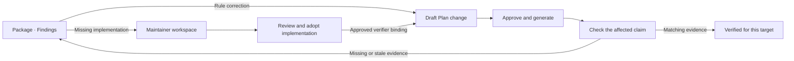

# Resolving work discovered during package authoring

**Proposed design for the Badger kernel, server, dashboard and MCP.** The Engineer should be able to open a finding, see who can change the affected artifact, request that work, and inspect the evidence that satisfies the original claim. The next package generation should tell the Engineer which findings still apply. [Proposed ADR 0057](adr/0057-resolve-authoring-findings-across-generations.md)

## Where the six lanes fit

| Lane | Its responsibility | An example of work it can own |
| --- | --- | --- |
| Script | Checks claims about the six generated control-plane scripts, including state, guard and handoff behavior. The assembler owns their bytes. | Recheck the guard claim after an adopted change. A missing domain producer goes to its source or integration owner. |
| Reference | Checks the normalized protocol, resolved Skills, composition report and lane metadata. These are generated artifacts. | Trace a disputed prerequisite to its source and recheck the generated protocol. |
| Pause Points | Authors the decision-points and recovery references. | Correct inaccurate resume instructions in those two documents. |
| Workflow Entry | Authors the root `SKILL.md` guidance using the accepted Script input. | Correct the workflow entry instructions. |
| Skill Core | Authors guidance for each active internal Node using the accepted Script input. | Correct the relevant Node's `SKILL.md`. The implementation Skill it invokes has its own version and owner. |
| Skill Review | Reviews the five preceding lanes and the exact package evidence. | Check the repaired claim and record the independent review verdict. |

All six can report a finding. Their eligible claims, leaves, dependencies and review voting rules still come from the kernel. A finding can name an implementation that none of the six owns. [Authoring protocol](../packages/kernel/src/authoring/protocol.ts) · [Lane capability contract](../packages/kernel/src/authoring/dispatch.ts) · [Review brief](../packages/kernel/assets/skills/badger-create/reference/subagents/skill-reviewer.md)

## What the Engineer does

1. **Open Package → Findings.** As each lane finishes, show its observations as suggestions alongside the lane result. The row names the affected claim or operation, expected and observed behavior, source lanes, evidence, owner and next action. For the CQ wave, show eleven observations from two lanes and a separately completed Pause Points report.
2. **Review the proposed grouping.** A later lane can cite an existing finding ID. For new reports, offer exact subject matches and, when useful, one optional **Draft dispositions** job for the wave. The Engineer can link, split, keep separate, or dismiss a suggestion with a reason. A single Reference observation can support two findings. Similar prose can suggest a match. Only an exact typed identity or confirmed link establishes it.
3. **Choose the work and its destination.** Open the owning stage, request a draft, assign an implementation, request a check, or ask the person who holds a decision. Show the target, assignee, deliverable, acceptance example and the gate that uses it. **Dispatch ready work** previews the batch. Related actionable Plan edits share one draft. Independent assignments start together. A dependent edit shows the input it is waiting for.
4. **Review what came back.** A source change opens the reviewed patch and immutable Skill candidate. A runner change opens the executable identity and check results. **Adopt Skill version**, **Review Plan change**, or the owning repository's change review applies the result using its existing authority. **Verify against this generation** checks the adopted target. The same finding can show a reviewed implementation and a package check still due.
5. **Inspect the next generation.** Plan and proposal, Package and Evaluation show relevant findings from the same record. Each row explains what changed, which evidence still applies and who has the next action. The new lane handoff includes relevant finding IDs and evidence. The lane can confirm the fix, cite a continuing failure, or report a materially different problem.

A submitted report can start draft analysis, consistent with current wave repairs. The dashboard can confirm grouping and dispatch in one review and retain each source report's separate acceptance decision. Suggesting a finding alone confers no authority to edit a repository or adopt a requirement. An unambiguous, already-authorized Plan-only wave retains its automatic consolidated draft. [Current wave behavior](adr/0056-wave-plan-repairs.md) · [Existing human decisions](adr/0005-agents-draft-people-sign-off.md)

The paths can run in parallel. For a workflow that needs both a Plan correction and a new verifier, the implementation has a concrete output the Plan Agent can consume.

**When Plan work is ready.** Require a current Plan field or named insertion point, a specific change, and the authoritative inputs that make the change possible. Removing a rule that misstates Badger policy qualifies immediately. Binding a verifier qualifies when its approved identity and digest arrive. A request to document the same missing digest again leaves the finding with the verifier owner. Record the last disposition against the requirement, proposed edit and relevant inputs. Queue further Plan work when one of those changes or when the Engineer explicitly reopens the work with a reason. An Agent's suggested route to Plan alone cannot enqueue a repair.

## Which work Badger dispatches

| What needs to change | Owner and job | Result the Engineer can use |
| --- | --- | --- |
| An authored leaf or incorrect lane claim | The owning lane gets a bounded revision job for its current inputs. | Revised content or a new claim with citations, followed by the normal lane review. |
| Workflow meaning or an approved declaration | Questionnaire, Dossier, Plan or Proposal owns the change. Use its existing drafting and approval path. | An attributable Answer, approved Dossier, validated Plan delta or reviewed derived proposal. A Plan edit may depend on an implementation identity arriving first. |
| Source Skill or workflow-specific integration code | A maintainer implements in the designated source workspace. Badger issues a scoped implementation Drafting job or tracks an external assignment. | A reviewable patch or immutable revision, the resulting deliverable digest and the requested test result. Import or upload the new Skill version and adopt the pin through Sources when it is the implementation. |
| Runner, verifier or host integration | The deployment owner supplies the implementation or runs the requested check on the designated host. | A versioned runner or tool identity, a public verifier binding where required, and scoped evidence. The Plan Agent can now bind supplied values. |
| Defect in Badger | A Badger maintainer receives the affected kernel, generator, runtime, handoff or host behavior and a reproducing case. | A tested change, the delivered Badger revision and verification against that revision. A fix that changes generated bytes requires regeneration. |
| A new or unclear dependency | The Engineer assigns a **work request** specifying the responsible party, artifact, acceptance example and evidence due. A clarification can establish ownership first. | The same work and evidence lifecycle handles an unfamiliar artifact. Its domain name never needs to become a new lane or a new scheduler case. |

Implementation and verification reuse the Drafting job claim, save, finish and human review operations. The proposed job kinds are `implement-finding` and `verify-finding`. The assignee opens the work from Package or their Inbox and copies its job prompt into their Agent session. A claim pins the finding revision, target and base identity, governing requirement, bounded supporting files, allowed workspace or runner, and acceptance example. For implementation, the Agent returns an immutable change reference or bounded patch, the files or artifact it changes, and its test evidence. For verification it returns the checked subject and digest, check or fixture identity, outcome and evidence provenance. An unavailable prerequisite returns the specific input and responsible party. The dashboard can send the existing job back with feedback. [Drafting sessions](adr/0047-exclusive-drafting-sessions.md) · [MCP job handoff](../packages/mcp/src/jobs.ts)

The Engineer's local Agent can work in an authorized checkout or a disposable worktree at the pinned base. The assignment records the repository identity and scoped paths. Local host configuration resolves the authorized checkout. Badger stores bounded results or immutable references. Repository review, merge, deployment and source adoption use their respective owners' controls. An external maintainer can supply evidence through the Engineer or an authorized job without receiving access to the rest of the workflow. Badger's Evaluation worker retains its existing scope for generated code. [Immutable source imports](adr/0029-registered-git-skill-versions.md) · [Evaluation execution contract](adr/0032-isolated-immutable-evaluations.md)

## What survives regeneration

| Record | Identity and meaning |
| --- | --- |
| Observation | The immutable source job, saved result hash, lane or review vote, claim and finding locator. Preserve its original wording and citations. A revised result supersedes that observation. |
| Finding | A stable ID within a Workflow version. Record the affected subject, governing requirement, impact and condition for closure. Link all supporting observations. One observation may support multiple findings. |
| Work | A deliverable for one target with an accountable person, input revisions, acceptance example and job or external reference. A finding can require multiple kinds of work. One implementation can serve multiple findings. |
| Evidence | An immutable artifact or receipt, its producer, the subject and inputs actually checked, and the outcome. Record the authority that accepted a human decision or verified a machine result. |

Show a finding as **Suggested**, **Open**, **Awaiting evidence**, or **Verified** for the selected target. Work progress appears alongside it. A verified finding with a changed relevant input shows **Recheck required**. **No longer applicable** records the reviewed source or scope change and reason. Dismissing an erroneous observation retains its history. Absence from a later report supplies no evidence of resolution.

Use a stable subject such as a Node and operation, a declared artifact role, a Skill entry, or a kernel rule. Keep the current Skill hash, runner identity, package digest and policy revision as verification inputs. Regeneration with the same inputs redisplays existing work. A changed workbook invalidates proof scoped to those bytes. A changed runner invalidates its execution proof. A package-bound check runs against the new assembled bytes. A source-only result can still apply to the identical source digest. Earlier verified generations remain inspectable.

References to a lane's `inputs/` folder resolve through the original job, result revision and file digest. Each new claim gets readable evidence under its own bounded handoff or an access-checked resource for the original bytes. A missing or stale source is shown explicitly. Rechecking a finding uses the current lane claims and dependencies. Historical acceptance provides context for that check.

The server commits an accepted routing decision, updated finding revisions and newly queued jobs together. Use existing Workflow version locks, expected revisions and request IDs. Enforce one active job per work identity, target, operation and relevant input basis. Several findings can link to that same work identity. Concurrent reports or retries reuse it. A new package ID can trigger a package-bound **check** while outstanding source implementation stays assigned. Supersede provisional links and pending jobs when their last supporting submission changes or is rejected. Accepted evidence and independently supported work retain their provenance.

## What can close a finding

Use the originating claim's acceptance condition. A Plan wording error can close when the revised, approved rule and its affected projections match the governing authority. A missing capability requires the adopted implementation and its relevant behavior check. A passing generic test counts only for the behavior and inputs it exercised. An Agent's `addressed` or `needs-evidence` response records its disposition. The kernel checks a machine receipt against its declared scope and trusted verifier where applicable. A human judgment uses the existing authorized, hash-bound decision. An external issue, patch link or unverified Agent report can advance work to **Awaiting evidence**. Verification determines closure for the applicable target.

Record the **first stage that needs the evidence**. Missing authorship evidence continues to hold the affected lane and its dependants. An assembly-ready finding whose allowed check needs assembled bytes may proceed to Evaluation under the kernel's deferral rules. The required check then holds Package review until its result matches the candidate. A domain-specific external check requires its own approved evidence contract. Runtime Decisions still require attributable receipts for the actual Run and Attempt. This avoids requiring a final package receipt as a prerequisite for creating the package that must be checked. [Existing Evaluation obligations](../packages/kernel/src/authoring/concerns.ts) · [Package review checks](../packages/kernel/src/publish/lifecycle.ts) · [Runtime receipts](adr/0054-workflow-approval-requirements-and-verifier-pins.md)

## CQ pilot walkthrough

The following grouping is a proposed Engineer disposition of the eleven observations on package `f61971b2`. Numbers refer to each lane's submitted finding order. Their shared reference to two verifier roles makes overlap visible.

| Finding | Script | Reference | Work and closure evidence |
| --- | --- | --- | --- |
| Unwarranted uploader-attestation prerequisite | 6 | 3 | Correct the approved Plan's mandatory wording and its derived guidance through a Plan repair. Show the optional Skill Library review separately from the Dossier's executable disclosures. An intentional workflow-specific restriction requires an attributable governing rule. |
| Missing episode evidence producer | 1 | 1 | The workflow or Skill maintainer implements the producer for the issue descriptor, selected workbook and verdict snapshot. Review the patch, adopt a supported implementation, and verify an edited-workbook example against its pinned bytes. |
| Term-review verifier | 2 | 2 | The verifier owner supplies the executable digest and public key. The Plan Agent binds them to the four recording operations. Exercise an approving case and rejection of changed bytes. |
| Inline signed permission handoff | 3 | 4 | The workflow integration owner connects the existing signed-in Decision to the exact native action. A disposable test exercises permission against the selected bytes and proves a changed Attempt requires new permission. |
| Offline verifier and runner | 4 | 2 | The runner owner provides the binding and evidence for offline preflight, resume and terminal checks. Verify the actual candidate, approved scope and runner identity. |
| Independent Stage 8 authoring or permitted skip | 5 | 5 | The runner owner demonstrates isolation on the selected route, or the Engineer chooses a permitted skip with its matching receipt. Evidence states which route was exercised. |

For the producer, prefer a reviewed change to an appropriate existing Skill when the workflow declares exactly ten. A separate implementation source requires explicit adoption through the owning Source and Dossier process. If the required host handoff has no supported Badger binding, the implementation assignment goes to Badger and stays visible until a delivered capability can be bound. Uploading a patch as evidence alone cannot make it executable.

## Changes in the codebase and delivery order

1. **Persist findings and route individual items.** The kernel's authoring types, output validation and handoff gain structured observations and references to earlier findings. Add a numbered PostgreSQL migration for findings, source observation links, work and evidence revisions. The server invokes the kernel rules from lane submission and human review. Replace whole-report routing in `syncWavePlanRepairs` with selection of actionable Plan items. Add the Findings view in Package and links from Plan drafting. Repeated waiting items return the outstanding work and owner. This slice alone prevents the unchanged mixed wave from becoming another eleven-item Plan draft. [Current output type](../packages/kernel/src/authoring/types.ts) · [Lane acceptance](../packages/server/src/authoring.ts) · [Wave scheduler](../packages/server/src/drafting/wave-plan-repairs.ts) · [Dashboard](../packages/web/src/pages/workflows/WorkflowAuthoring.tsx)
2. **Deliver and adopt implementation work.** Add the implementation and verification job schemas to the server and MCP, the assignment and result views to the dashboard, and links into existing source adoption and Plan review. Mark optional library diagnostics as advisory in the kernel contract delivered to Plan and lane jobs. For a typed mandatory prerequisite, the compositor validates a reference to the applicable platform rule or approved Dossier requirement. A reference to an optional attestation, by itself, fails that validation. Surface legacy prose conflicts for human review. [Source of the diagnostic](../packages/kernel/src/factory/script-effects.ts) · [Attestation policy](adr/0052-advisory-skill-script-effect-reviews.md) · [Plan composition](../packages/kernel/src/factory/plan-composition.ts) · [Drafting job schemas](../packages/server/src/drafting/schema.ts)
3. **Verify across generations.** Give the kernel a single projection over finding revisions, applicable evidence and the current target. Use it in dispatch, generation previews, assembly, Evaluation and Package review. Include the relevant projection and hash in each bounded lane handoff. The collaborative server persists these records above the generation namespace. Standalone authoring can use a protected project record with an explicit workflow lineage. Both use the same kernel rules. WorkflowRuntime remains the authority for Run receipts. [Handoff builder](../packages/kernel/src/authoring/dispatch.ts) · [Generation](../packages/server/src/packages.ts) · [Evaluation](../packages/server/src/evaluations.ts)

**Compatibility.** Ship a versioned lane envelope alongside the current one. Read a legacy report's action as a suggested route, then expose its individual findings for review. Index the current pending wave using its immutable report hashes. An existing claimed or submitted repair keeps its original schema, lease, links and review path. Expose prior `needs-evidence` dispositions as candidate links. Reuse the existing repair or explicitly supersede it after review. Historical plans, published bytes and human approvals keep their identities. A successor Workflow version may explicitly adopt relevant findings with provenance to the earlier version.

**Acceptance for the proposed change.** Start with a mixed submitted wave and no lane reviews clicked. Verify that the dashboard shows all observations and their original citations, both verifier subjects remain distinct, independent work is dispatchable, and only ready Plan edits enter the Plan draft. Regenerate once with identical source inputs and again with a changed runner. Check work deduplication, the narrower recheck and the surviving historical result. Exercise an expired lease, two concurrent dispatch requests, a rejected observation and a patch whose subject hash differs from the adopted version. In an unrelated document-export workflow, send a vendor-specific rendering defect to its maintainer and close it on a verified output sample. Route a mistaken Node instruction directly to Skill Core. Exercise both paths using the same schema and dispatch rules as the CQ pilot.
