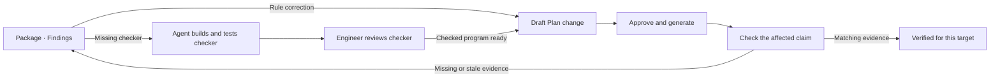

# Resolving work discovered during package authoring

**Proposed design for the Badger kernel, server, dashboard and MCP.** One Engineer maintains the Skills and workflow, dispatches Agent jobs, and approves the Dossier, Plan, proposal and package through publication. The Engineer asks Field experts for domain input when needed. Each finding identifies the artifact to change, the next job and the evidence that will show the fix worked. [Proposed ADR 0057](adr/0057-resolve-authoring-findings-across-generations.md)

## One Engineer takes the workflow from authoring to publication

The dashboard offers **Dispatch work**, **Review result**, **Ask an expert**, and the existing approval actions. Technical work defaults to the workflow's Engineer. The Engineer can dispatch several jobs at once and open their prompts in separate Agent sessions. An expert answers the particular question sent to them. Agents return drafts or test results. The Engineer reviews and signs the human approvals in the dashboard.

For a new workflow, choose the Engineer once, defaulting to its creator. The proposed setup assigns the existing workflow-scoped Engineer and Workflow owner permissions to that person together. Use the Engineer's existing Skill Library access for the Skills they maintain. For an existing workflow, use its current permissions and offer the same setup to a person already authorized to manage its role bindings. Future colleagues receive access when they use the published package. [Current role checks](../packages/server/src/workflow-access.ts) · [Workflow creation](../packages/server/src/workflows.ts) · [Package approval and publication](adr/0038-workflow-owner-review-and-publication.md)

## What a runner and a checker do

Suppose a colleague clicks **Check workbook**. The **runner** is the software on a computer that starts the check. The **checker** is the program that opens the workbook and tests whether its contents match what the Engineer approved. The colleague receives a result.

| When | What Badger should know |
| --- | --- |
| Draft the Plan | Describe what to check, what passing means, and any requirements such as working offline. An Engineer can plan the check before the program exists. Future users and their computers can be chosen later. |
| Build and review the checker | An implementation job supplies the actual program when one is needed. Badger calculates a fingerprint (SHA-256) from the file's exact contents. Identical copies give the same fingerprint on different computers. If the approved workflow requires signed results, bind that fingerprint and the trusted verifier's public key when both are available. |
| Run the published package | A colleague starts the workflow on a supported installation. The runner checks the prerequisites in that environment and runs the checker. A signed check uses the configured trusted verifier. The private signing key stays with that verifier. The run records the actual workbook, outcome and relevant tool versions. |

The fingerprint answers “Which copy of the program?” A verified signature answers “Did the trusted verifier issue this result for this run?” Use an ordinary local check when its result meets the approved requirement. Use a signed result only when the workflow calls for that additional proof. Badger's current signed-check option stores the fingerprint and public key together in `verification.verifierPin`. The proposed dashboard reads them from the reviewed program and the configured verifier for the Engineer to confirm. A missing required signer stays an implementation or configuration task. A portable release can name the same trusted verifier for many installations. On an offline route, verify that the check can run with its approved local setup. [Current signed-check contract](adr/0054-workflow-approval-requirements-and-verifier-pins.md)

## Where the six lanes fit

| Lane | Its responsibility | An example of work it can own |
| --- | --- | --- |
| Script | Checks claims about the six generated control-plane scripts, including state, guard and handoff behavior. The assembler owns their bytes. | Recheck the guard claim after an adopted change. Report a missing domain producer so the Engineer can dispatch an implementation job. |
| Reference | Checks the normalized protocol, resolved Skills, composition report and lane metadata. These are generated artifacts. | Trace a disputed prerequisite to its source and recheck the generated protocol. |
| Pause Points | Authors the decision-points and recovery references. | Correct inaccurate resume instructions in those two documents. |
| Workflow Entry | Authors the root `SKILL.md` guidance using the accepted Script input. | Correct the workflow entry instructions. |
| Skill Core | Authors guidance for each active internal Node using the accepted Script input. | Correct the relevant Node's `SKILL.md`. A code change to the Skill it invokes goes through that Skill's version review. |
| Skill Review | Reviews the five preceding lanes and the exact package evidence. | Check the repaired claim and record the independent review verdict. |

All six can report a finding. Their eligible claims, leaves, dependencies and review voting rules still come from the kernel. A finding can name an implementation that none of the six owns. [Authoring protocol](../packages/kernel/src/authoring/protocol.ts) · [Lane capability contract](../packages/kernel/src/authoring/dispatch.ts) · [Review brief](../packages/kernel/assets/skills/badger-create/reference/subagents/skill-reviewer.md)

## What the Engineer does

1. **Open Package → Findings.** As each lane finishes, show its observations as suggestions alongside the lane result. The row names the affected claim or operation, expected and observed behavior, source lanes, evidence and next action. For the CQ wave, show eleven observations from two lanes and a separately completed Pause Points report.
2. **Review the proposed grouping.** A later lane can cite an existing finding ID. For new reports, offer exact subject matches and, when useful, one optional **Draft dispositions** job for the wave. The Engineer can link, split, keep separate, or dismiss a suggestion with a reason. A single Reference observation can support two findings. Similar prose can suggest a match. Only an exact typed identity or confirmed link establishes it.
3. **Dispatch ready work.** Show the affected file or stage, proposed job, expected result and an example that should pass. The Engineer dispatches the batch, or uses **Ask an expert** for a domain question. Related Plan edits share one draft. Implementation and test jobs can run in parallel. A dependent edit shows the input it awaits.
4. **Review what came back.** A source change opens the patch and Skill candidate. A checker change shows which program was tested and whether the example passed. **Adopt Skill version** or **Review Plan change** applies the reviewed result through its existing stage. **Verify against this generation** checks the adopted target. The same finding can show a reviewed implementation and a package check still due.
5. **Inspect the next generation.** Plan and proposal, Package and Evaluation show relevant findings from the same record. Each row explains what changed, which evidence still applies and what the Engineer or an Agent can do next. The new lane handoff includes relevant finding IDs and evidence. The lane can confirm the fix, cite a continuing failure, or report a materially different problem.

A submitted report can start draft analysis, consistent with current wave repairs. The dashboard can confirm grouping and dispatch in one review and retain each source report's separate acceptance decision. Suggesting a finding alone confers no authority to edit a repository or adopt a requirement. An unambiguous, already-authorized Plan-only wave retains its automatic consolidated draft. [Current wave behavior](adr/0056-wave-plan-repairs.md) · [Existing human decisions](adr/0005-agents-draft-people-sign-off.md)

The paths can run in parallel. For a workflow that needs both a Plan correction and a new verifier, the implementation has a concrete output the Plan Agent can consume.

**When Plan work is ready.** Require a current Plan field or named insertion point, a specific change, and the authoritative inputs that make it possible. Removing a rule that misstates Badger policy qualifies immediately. Describing a new check can also proceed immediately. For an explicitly signed check, the Plan Agent can fill in its binding once the implementation job returns the approved program's fingerprint and the trusted public key. Until then the dashboard shows the implementation job. Queue further Plan work when the proposed edit or relevant inputs change, or when the Engineer explicitly reopens the work with a reason.

## Which work Badger dispatches

| What needs to change | Job the Engineer dispatches | Result the Engineer can use |
| --- | --- | --- |
| An authored leaf or incorrect lane claim | The owning lane gets a bounded revision job for its current inputs. | Revised content or a new claim with citations, followed by the normal lane review. |
| Workflow meaning or an approved declaration | Use the existing Questionnaire, Dossier, Plan or Proposal path. Ask a Field expert when the meaning needs clarification. | An attributable Answer, approved Dossier, validated Plan change or reviewed derived proposal. |
| Source Skill or workflow-specific integration code | An implementation job works in the relevant source workspace. | A reviewable patch or immutable revision and its tests. The Engineer reviews, imports or uploads and adopts the new Skill version through Sources. |
| Checker or software that runs it | An implementation job builds or configures the tool. A verification job exercises it on a suitable installation. | A tested program and the result on that installation. An explicitly signed check also supplies the program fingerprint and trusted public key. |
| Defect in Badger | An implementation job receives the affected kernel, generator, runtime, handoff or host behavior and a reproducing case. | A tested change, the delivered Badger revision and verification against that revision. A fix that changes generated bytes requires regeneration. |
| A new or unclear dependency | The Engineer requests an investigation or implementation with the affected artifact, expected behavior and acceptance example. | The same work and evidence lifecycle handles an unfamiliar artifact. |

Implementation and verification reuse the Drafting job claim, save, finish and human review operations. The proposed job kinds are `implement-finding` and `verify-finding`. The Engineer opens the work from Package or their Inbox and copies the prompt into an Agent session. A claim pins the finding revision, target and base version, governing requirement, supporting files, allowed workspace and acceptance example. For implementation, the Agent returns a change reference or bounded patch and its test evidence. For verification it returns what it checked, the file fingerprint where relevant, the fixture, the outcome and where it ran. An unavailable prerequisite returns the specific missing input and next job or action. The Engineer can send the existing job back with feedback. [Drafting sessions](adr/0047-exclusive-drafting-sessions.md) · [MCP job handoff](../packages/mcp/src/jobs.ts)

The Engineer's local Agent can work in an authorized checkout or a disposable worktree at the pinned base. The assignment records the repository and scoped paths. Local host configuration resolves the checkout. Badger stores bounded results or immutable references. The Engineer reviews source changes and adopts them through the normal repository and Skill Library controls. Badger's Evaluation worker runs its existing checks for generated code. [Immutable source imports](adr/0029-registered-git-skill-versions.md) · [Evaluation execution contract](adr/0032-isolated-immutable-evaluations.md)

## What survives regeneration

| Record | Identity and meaning |
| --- | --- |
| Observation | The immutable source job, saved result hash, lane or review vote, claim and finding locator. Preserve its original wording and citations. A revised result supersedes that observation. |
| Finding | A stable ID within a Workflow version. Record the affected subject, governing requirement, impact and condition for closure. Link all supporting observations. One observation may support multiple findings. |
| Work | A deliverable for one target with input revisions, an acceptance example and a job or evidence reference. It belongs to the workflow's Engineer by default. A finding can require multiple kinds of work. One implementation can serve multiple findings. |
| Evidence | An immutable artifact or receipt, its producer, the subject and inputs actually checked, and the outcome. Record the authority that accepted a human decision or verified a machine result. |

Show a finding as **Suggested**, **Open**, **Awaiting evidence**, or **Verified** for the selected target. Work progress appears alongside it. A verified finding with a changed relevant input shows **Recheck required**. **No longer applicable** records the reviewed source or scope change and reason. Dismissing an erroneous observation retains its history. Absence from a later report supplies no evidence of resolution.

Use a stable subject such as a Node and operation, a declared artifact role, a Skill entry, or a kernel rule. Bind evidence to the inputs the check depends on, such as the Skill contents, checker fingerprint, package digest or policy revision. Regeneration with the same inputs redisplays existing work. A changed workbook invalidates proof scoped to those bytes. An offline check also records the relevant environment when it runs. A package-bound check runs against the new assembled bytes. A source-only result can still apply to the identical source digest. Earlier verified generations remain inspectable.

References to a lane's `inputs/` folder resolve through the original job, result revision and file digest. Each new claim gets readable evidence under its own bounded handoff or an access-checked resource for the original bytes. A missing or stale source is shown explicitly. Rechecking a finding uses the current lane claims and dependencies. Historical acceptance provides context for that check.

The server commits an accepted routing decision, updated finding revisions and newly queued jobs together. Use existing Workflow version locks, expected revisions and request IDs. Enforce one active job per work identity, target, operation and relevant input basis. Several findings can link to that same work identity. Concurrent reports or retries reuse it. A new package ID can trigger a package-bound **check** while outstanding source implementation stays assigned. Supersede provisional links and pending jobs when their last supporting submission changes or is rejected. Accepted evidence and independently supported work retain their provenance.

## What can close a finding

Use the originating claim's acceptance condition. A Plan wording error can close when the revised, approved rule and its affected projections match the governing authority. A missing capability requires the adopted implementation and its relevant behavior check. A passing generic test counts only for the behavior and inputs it exercised. An Agent's `addressed` or `needs-evidence` response records its disposition. The kernel checks a machine receipt against its declared scope and trusted verifier where applicable. A human judgment uses the existing authorized, hash-bound decision. An external issue, patch link or unverified Agent report can advance work to **Awaiting evidence**. Verification determines closure for the applicable target.

Record the **first stage that needs the evidence**. Missing authorship evidence continues to hold the affected lane and its dependants. An assembly-ready finding whose allowed check needs assembled bytes may proceed to Evaluation under the kernel's deferral rules. The required check then holds Package review until its result matches the candidate. A domain-specific external check requires its own approved evidence contract. Runtime Decisions still require attributable receipts for the actual Run and Attempt. This avoids requiring a final package receipt as a prerequisite for creating the package that must be checked. [Existing Evaluation obligations](../packages/kernel/src/authoring/concerns.ts) · [Package review checks](../packages/kernel/src/publish/lifecycle.ts) · [Runtime receipts](adr/0054-workflow-approval-requirements-and-verifier-pins.md)

## CQ pilot walkthrough

The following grouping is a proposed Engineer disposition of the eleven observations on package `f61971b2`. Numbers refer to each lane's submitted finding order. Their shared reference to two verifier roles makes overlap visible.

| Finding | Script | Reference | Work and closure evidence |
| --- | --- | --- | --- |
| Unwarranted uploader-attestation prerequisite | 6 | 3 | Correct the approved Plan's mandatory wording and its derived guidance through a Plan repair. Show the optional Skill Library review separately from the Dossier's executable disclosures. An intentional workflow-specific restriction requires an attributable governing rule. |
| Missing episode evidence producer | 1 | 1 | The Engineer dispatches an implementation job to produce the issue descriptor, selected workbook and verdict snapshot. The Engineer reviews the patch and adopts the revised Skill. A verification job exercises an edited-workbook example. |
| Term-review verifier | 2 | 2 | The CQ Plan calls for signed results. An implementation job builds or selects the checker. Badger calculates its fingerprint. Once the Engineer approves the checker and the trusted verifier's public key, the Plan Agent can bind them to the four recording operations. Exercise a matching workbook and a changed copy. |
| Inline signed permission handoff | 3 | 4 | An Agent connects the Engineer's signed-in Decision to the exact native action. A disposable test exercises permission against the selected bytes and shows that a changed Attempt requires new permission. |
| Offline verifier and runner | 4 | 2 | The Engineer dispatches work to implement and test the required offline checks. The test records the actual candidate, tools, scope and result before, during and after an interrupted test run. A later installation checks its own prerequisites and each Run records its own results. |
| Independent Stage 8 authoring or permitted skip | 5 | 5 | A verification job demonstrates isolation on the selected route, or the Engineer chooses a permitted skip and records its receipt. The result names the route exercised. |

For the producer, prefer a reviewed change to an appropriate existing Skill when the workflow declares exactly ten. A separate implementation source requires explicit adoption through the owning Source and Dossier process. If the required host handoff has no supported Badger binding, the implementation assignment goes to Badger and stays visible until a delivered capability can be bound. Uploading a patch as evidence alone cannot make it executable.

## Changes in the codebase and delivery order

1. **Persist findings and route individual items.** The kernel's authoring types, output validation and handoff gain structured observations and references to earlier findings. Add a numbered PostgreSQL migration for findings, source observation links, work and evidence revisions. The server invokes the kernel rules from lane submission and human review. Replace whole-report routing in `syncWavePlanRepairs` with selection of actionable Plan items. Add the Findings view in Package and links from Plan drafting. Show the outstanding job when the same finding returns. Set up the single Engineer's workflow permissions together in the creation transaction and display one Engineer in the dashboard. [Current output type](../packages/kernel/src/authoring/types.ts) · [Lane acceptance](../packages/server/src/authoring.ts) · [Wave scheduler](../packages/server/src/drafting/wave-plan-repairs.ts) · [Dashboard](../packages/web/src/pages/workflows/WorkflowAuthoring.tsx)
2. **Deliver and adopt implementation work.** Add the implementation and verification job schemas to the server and MCP, dispatch and result views to the dashboard, and links into existing source adoption and Plan review. Compute fingerprints directly from reviewed program bytes. Record an environment's prerequisites and tool versions when an environment-specific check runs. Mark optional library diagnostics as advisory in the kernel contract delivered to Plan and lane jobs. For a typed mandatory prerequisite, the compositor validates a reference to the applicable platform rule or approved Dossier requirement. A reference to an optional attestation, by itself, fails that validation. Surface legacy prose conflicts for human review. [Source of the diagnostic](../packages/kernel/src/factory/script-effects.ts) · [Attestation policy](adr/0052-advisory-skill-script-effect-reviews.md) · [Plan composition](../packages/kernel/src/factory/plan-composition.ts) · [Drafting job schemas](../packages/server/src/drafting/schema.ts)
3. **Verify across generations.** Give the kernel a single projection over finding revisions, applicable evidence and the current target. Use it in dispatch, generation previews, assembly, Evaluation and Package review. Include the relevant projection and hash in each bounded lane handoff. The collaborative server persists these records above the generation namespace. Standalone authoring can use a protected project record with an explicit workflow lineage. Both use the same kernel rules. WorkflowRuntime remains the authority for Run receipts. [Handoff builder](../packages/kernel/src/authoring/dispatch.ts) · [Generation](../packages/server/src/packages.ts) · [Evaluation](../packages/server/src/evaluations.ts)

**Compatibility.** Ship a versioned lane envelope alongside the current one. Read a legacy report's action as a suggested route, then expose its individual findings for review. Index the current pending wave using its immutable report hashes. An existing claimed or submitted repair keeps its original schema, lease, links and review path. Expose prior `needs-evidence` dispositions as candidate links. Reuse the existing repair or explicitly supersede it after review. Historical plans, published bytes and human approvals keep their identities. A successor Workflow version may explicitly adopt relevant findings with provenance to the earlier version.

**Acceptance for the proposed change**

- One Engineer creates a workflow, maintains a Skill, dispatches jobs, approves the Plan and proposal, generates and evaluates the package, and approves and publishes it using the same signed-in account. Ask one Field expert a domain question. The Engineer can complete a second example using already-confirmed facts.
- At Plan drafting, describe a check for which no executable exists yet. Show **Implement checker**. After the file exists, compute its fingerprint from the reviewed bytes. Publish before choosing individual users. Two colleagues given access afterwards can use the same package on supported installations. Identical checker bytes have the same fingerprint. A changed checker fails an explicitly pinned check. A signed-check installation needs access to its configured trusted verifier before running that step.
- Start with a mixed submitted wave and no lane reviews clicked. Preserve all observations and citations, separate the two verifier subjects, dispatch independent work and send only ready Plan edits to Plan. Regenerate once with identical source inputs and once after changing a relevant tool on the test installation. Verify work deduplication, the narrower recheck and the historical result.
- Exercise an expired lease, two concurrent dispatch requests, a rejected observation and a patch whose subject hash differs from the adopted version. For an unrelated document-export workflow, dispatch an implementation job for a vendor-specific rendering defect and close it on a verified output sample. Route a mistaken Node instruction directly to Skill Core using the same dispatch rules.
